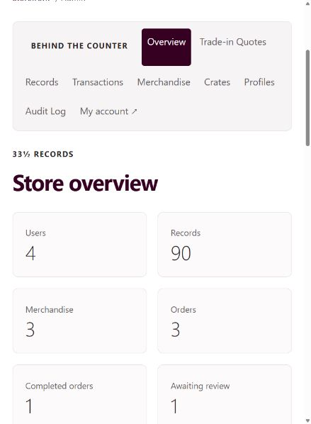
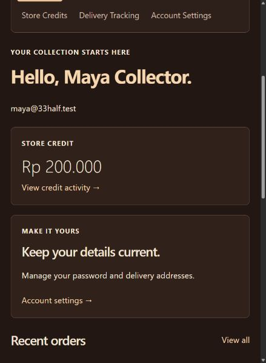
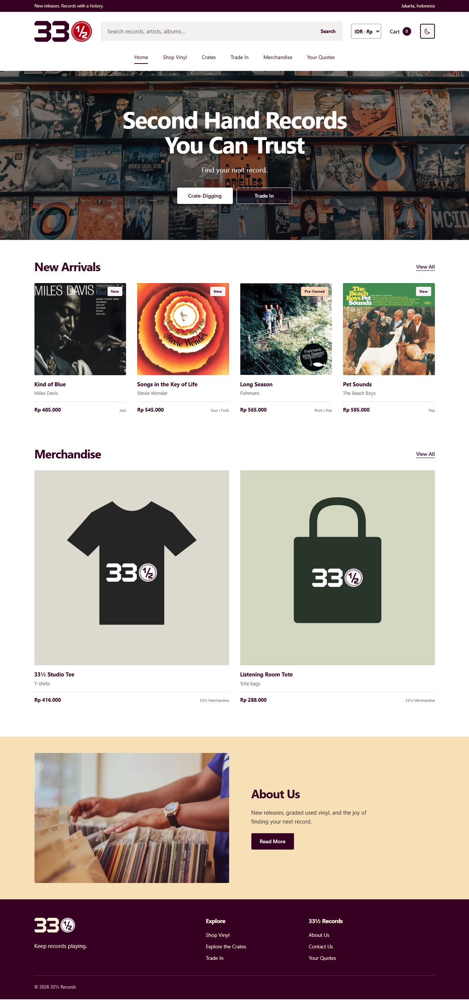
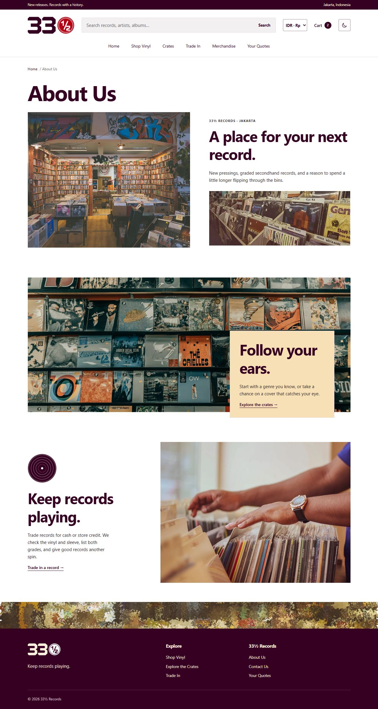
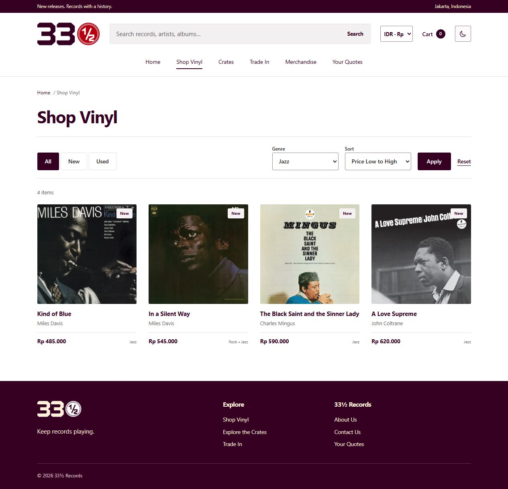
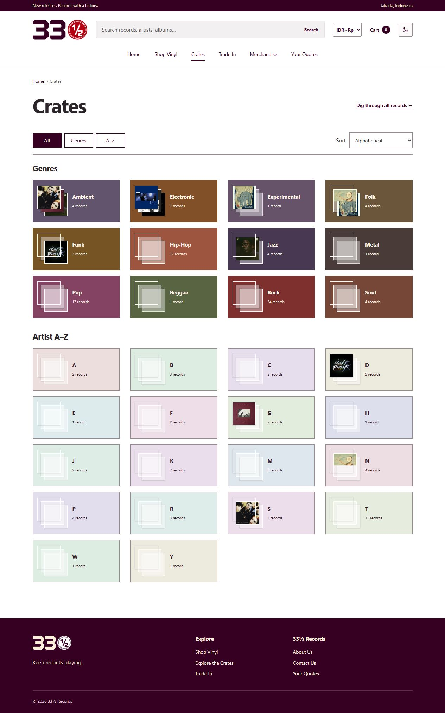
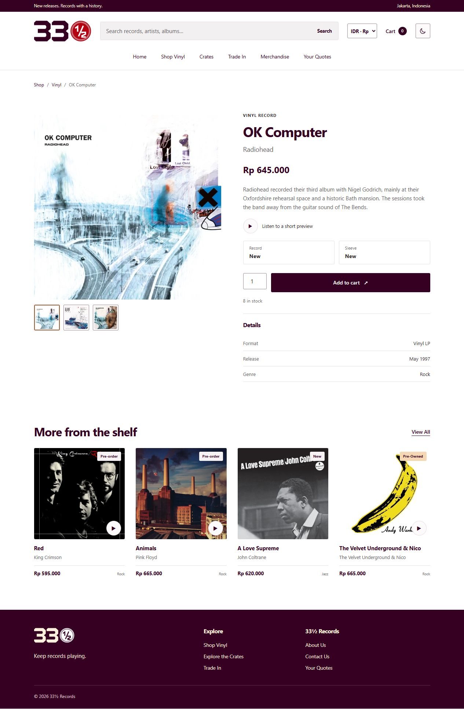
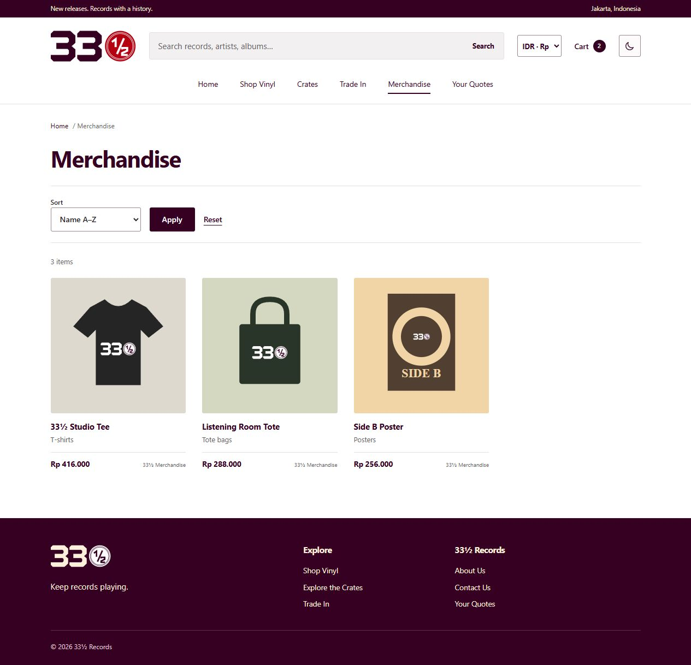
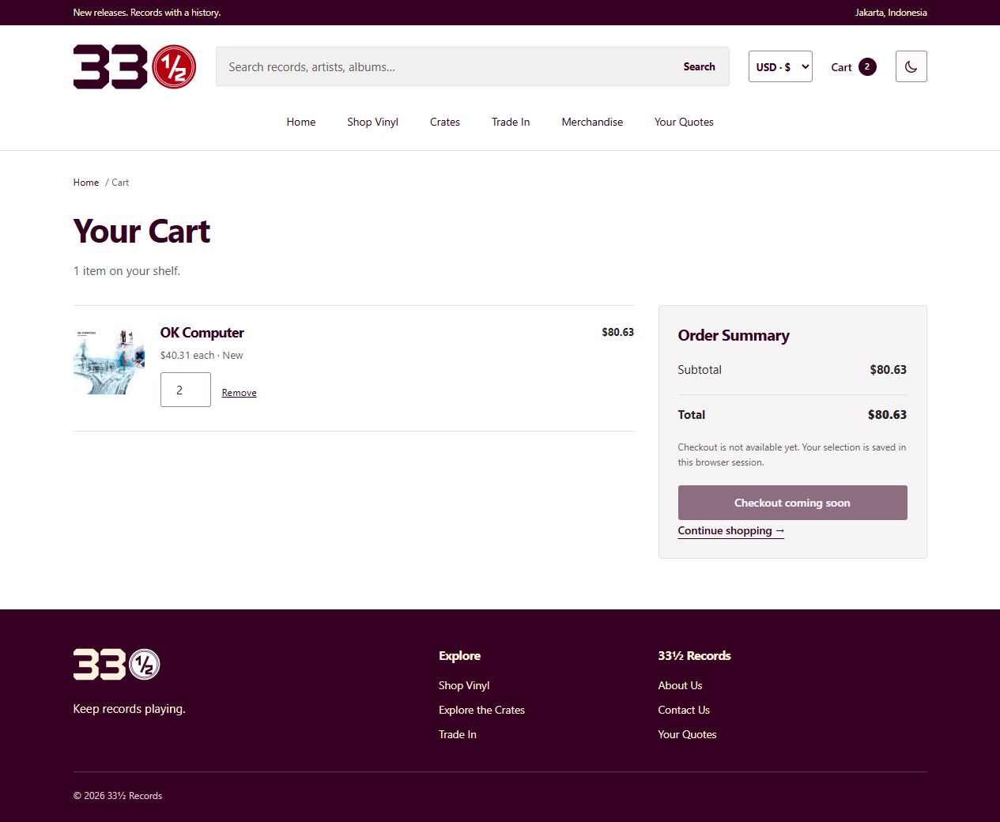

# 33½

A Laravel vinyl store and trade-in platform with 90 records, merchandise, customer accounts, persistent carts, pickup/delivery checkout, store credits, and a protected admin area. Built with standard controllers, Eloquent models, Blade, Bootstrap 5, and small vanilla JavaScript modules.

## Screenshots

Select a screenshot to open it at full size. The original storefront screenshots below predate the account and checkout update.

| Admin overview | Customer account |
| --- | --- |
| [](docs/screenshots/12-admin-overview.jpg) | [](docs/screenshots/13-customer-account.jpg) |

| Storefront and new arrivals | About Us |
| --- | --- |
| [](docs/screenshots/01-home.jpg) | [](docs/screenshots/10-about.jpg) |

| Filtered vinyl catalog | Genre and artist crates |
| --- | --- |
| [](docs/screenshots/02-vinyl-catalog.jpg) | [](docs/screenshots/03-crates.jpg) |

| Crate Digging in dark mode | Record detail and sleeve gallery |
| --- | --- |
| [](docs/screenshots/04-crate-digging-dark.jpg) | [](docs/screenshots/05-record-detail.jpg) |

| Merchandise | Cart in USD |
| --- | --- |
| [](docs/screenshots/09-merchandise.jpg) | [](docs/screenshots/06-cart-usd.jpg) |

| Trade-in form | Demo quote history |
| --- | --- |
| [](docs/screenshots/07-trade-in.jpg) | [](docs/screenshots/08-quote-history.jpg) |

### Mobile storefront

<a href="docs/screenshots/11-mobile-home.jpg"></a>

## Stack

- Laravel 12 / PHP 8.2+
- Blade templates
- MySQL schema (SQLite also works for local demos)
- Local Bootstrap 5.3.9 CSS and JavaScript from `public/assets/bootstrap`, plus the existing vintage theme
- Small vanilla JavaScript modules, built with Vite; no jQuery dependency

## Run with XAMPP

1. Start Apache and MySQL in the XAMPP Control Panel.
2. Install dependencies using `composer install` and `npm ci`. Copy `.env.example` to `.env` if needed, then run `php artisan key:generate` for a new environment. Use XAMPP's PHP 8.2+ on your PATH, or run `C:\xampp\php\php.exe artisan`.
3. Use the MySQL settings from `.env.example`. The default schema is `33-half` at `127.0.0.1:3306`. Adjust the account credentials for your installation.
4. Set the development account variables described below. To keep your existing database, run `php artisan migrate` and then `php artisan db:seed`. For a new or disposable database, use `php artisan migrate:fresh --seed`; this drops existing tables in the selected database.
5. Run `php artisan storage:link` for uploaded catalog images, then `npm run build`.
6. Copy the directives from [the Apache example](docs/xampp/apache.conf.example) into XAMPP's `apache/conf/extra/httpd-vhosts.conf`. Replace both example paths with your project's absolute `public` folder path. Restart Apache and open [the storefront](http://localhost/33-half/). The database is visible in [phpMyAdmin](http://localhost/phpmyadmin/).

For Laravel's development server, set `APP_URL=http://127.0.0.1:8000` and run `php artisan serve`. For live CSS/JS edits, run `npm run dev` in a second terminal. The test suite uses SQLite in memory.

## Accounts and admin setup

Set these in your local `.env` before seeding. Choose your own strong passwords; no credentials are committed:

```dotenv
DEV_ADMIN_NAME="Store Admin"
DEV_ADMIN_EMAIL=your-local-admin@example.test
DEV_ADMIN_PASSWORD=
SEED_DEMO_DATA=true
DEMO_USER_PASSWORD=
```

Use passwords with at least 8 characters, including letters and numbers. `php artisan db:seed` creates the configured admin only in `APP_ENV=local`. It does not reset an existing account's password or silently promote it. If credentials are omitted, seeding continues and explains how to create an admin.

For an interactive, secure setup on any environment, run:

```sh
php artisan user:admin
```

The command asks for an email, name, and hidden password confirmation. An existing account can be promoted with `php artisan user:admin email@example.com`; promotion requires confirmation in the terminal. This command requires access to the server.

With `SEED_DEMO_DATA=true` and `DEMO_USER_PASSWORD` configured, local seeding also creates `maya@33half.test`, `adi@33half.test`, and `nadia@33half.test`. They share the configured demo password. Samples include completed/pending orders, pickup and delivery histories, pending/offered/completed trade-ins, a credit issuance/redemption, saved addresses, and tote variants. Repeating the seed does not duplicate these transactions or reset stock, account passwords, or catalog edits. Development accounts and transactions are never seeded in production.

Open `/login`, then use the profile icon next to Cart. Admins have an **Admin Dashboard** link to `/admin`. Guests can browse the shop and view the trade-in introduction; carts, checkout, quotes, orders, and account pages require sign-in.

## Payments, credits, and fulfillment

Payments use an explicit **local manual workflow**. Checkout reserves stock and applies credit in one transaction. A customer cannot mark an order paid. An admin verifies the manual payment in **Transactions**, then advances fulfillment. An order fully covered by credit is marked paid by the server.

- Pickup: Pending → Confirmed → Ready for Pickup → Picked Up.
- Delivery: Pending → Confirmed → Processing → Shipped → Out for Delivery → Delivered.
- Unpaid orders can be cancelled before dispatch/pickup. Paid orders can be refunded before dispatch/pickup, after the admin returns any manual payment and records a reference. Either action restores stock and applied credit once. Returns after dispatch are outside this workflow.
- Trade-ins: Pending Review → Offer Sent → Accepted/Declined → Waiting for Delivery → Delivered → Inspection → Completed. Customers choose an offered cash/credit amount and delivery/drop-off; admins record inspection and completion. Credit is issued only on completion. Cash payouts are made manually and require a completion note.

Set `STOREFRONT_DELIVERY_FEE` (whole IDR), `STOREFRONT_PICKUP_LOCATION`, `STOREFRONT_PICKUP_INSTRUCTIONS`, and `STOREFRONT_PAYMENT_INSTRUCTIONS` to your store's details. Delivery fees are flat-rate; carrier tracking is entered by an admin. There is no payment gateway or carrier API.

Password resets use Laravel's expiring, single-use reset tokens. With `MAIL_MAILER=log`, the reset email/link is written to `storage/logs/laravel.log`; it is not sent to an inbox. Configure SMTP for real email delivery. Use your real `APP_URL` so links point to the right host. For deployment, use HTTPS, `APP_ENV=production`, `APP_DEBUG=false`, and suitable database/mail credentials.

Quote photos stay in private storage and are served only to their owner or an admin. Product/crate artwork uses `storage/app/public`; image replacements delete only the old managed upload after a successful save. Archiving products/crates preserves historical records and their files. Apache/XAMPP upload limits are set per project in `public/.htaccess`; with `artisan serve`, set `upload_max_filesize=10M` and `post_max_size=64M` in the PHP configuration to support six 10 MB quote photos.

## Main folders

| Path | Purpose |
| --- | --- |
| `app/Models` | Catalog, accounts, orders, trade-ins, credit ledger, and status transitions |
| `app/Http/Controllers` | Public pages, authentication, account/checkout, and conventional admin CRUD |
| `app/Policies`, `app/Http/Middleware` | Ownership, active accounts, and admin permissions |
| `database/migrations` | Catalog, accounts, commerce, histories, and audit tables |
| `database/seeders/CatalogSeeder.php` | 90 chart albums and three merchandise mockups |
| `resources/views/layouts` | Shared HTML shell |
| `resources/views/components` | Reusable storefront pieces |
| `resources/views/pages` | Home, catalog, directory, crate, cart, and information pages |
| `resources/views/products` | Shared product detail page |
| `resources/views/account`, `resources/views/admin`, `resources/views/auth` | Customer, management, and sign-in screens |
| `resources/css/app.css` | Burgundy/cream design and responsive breakpoints |
| `resources/js` | Audio, crate, and cart modules |
| `public/images/demo`, `public/audio` | Local placeholder covers and original demo sound |
| `scripts/generate_demo_assets.py` | Recreates demo artwork and sound |

## Routes

| Route | Page |
| --- | --- |
| `/` | Home |
| `/shop` | All products |
| `/vinyl` | Vinyl |
| `/records/{slug}` | Vinyl detail |
| `/merch`, `/merch/{slug}` | Merchandise and detail |
| `/artists`, `/artists/{slug}` | Artist directory and collection |
| `/genres`, `/genres/{slug}` | Genre directory and collection |
| `/pre-orders` | Upcoming records |
| `/crate-digging` | Horizontal carousel of all records |
| `/crates` | Genre and artist crate directory |
| `/crates/artists/{letter}` | Carousel of artists beginning with a letter |
| `/crates/{slug}` | Store-curated crate carousel |
| `/trade-in`, `/your-quotes` | Trade-in request and account quote history |
| `/login`, `/register`, `/forgot-password` | Authentication and password reset |
| `/account`, `/account/settings`, `/account/credits` | Profile, addresses/password, and credit ledger |
| `/cart`, `/checkout` | Persistent account cart and pickup/delivery checkout |
| `/orders`, `/orders/{id}`, `/delivery-tracking` | Purchase snapshots and tracking history |
| `/admin` | Admin overview and management navigation |
| `/about`, `/contact` | Editable information pages |

The catalog already accepts simple query parameters: `q`, `genre`, `artist`, `label`, `min_price`, `max_price`, `availability`, and `sort`.

## Data model

`products` holds both vinyl and merchandise via `product_type`. Artists and genres are many-to-many; labels are one-to-many. Merchandise variants have independent prices and stock. Crates have names, descriptions, colors, covers, and associated records. Products, variants, and crates use soft deletes.

`users` stores the two roles, profile details, active status, and credit balance; addresses are separate. Each user has cart items, orders, quotes, and an append-only credit history. Orders have item/address/price snapshots, a payment record, and timestamped status/tracking events. Each quote represents one submitted record and stores its offer, accepted choice, photos, and status history without duplicating those fields across extra tables. Admin actions are recorded in `admin_audit_logs`; deactivating/demoting the last active admin is blocked.

Financial calculations use whole IDR integers. Existing product prices remain decimal columns for compatibility; admin input accepts whole rupiah. Transactions and row locks protect checkout, inventory, credit changes, and quote completion. Unique checkout tokens and credit references prevent duplicate orders/credit issuance. USD conversion affects display only. Credit-only payments, cancellations, and refunds are decided on the server.

The seed data in `database/data/albums.json` follows a [May 2026 snapshot of the Rate Your Music chart](https://www.jetpunk.com/user-quizzes/2747014/100-best-albums-of-all-time). Each album includes a short paraphrase of its Wikipedia introduction, up to three genres, an external artwork URL, and a local WebP copy. Where available, an Apple audio preview is included. Prices, stock, grades, and preorder flags are sample store data.

Product prices are stored in IDR. The header's IDR/USD selector saves a session preference. Set `STOREFRONT_IDR_PER_USD` to the number of rupiah per US dollar to change the site's fixed conversion rate. The default is 16,000.

## Interactive features

- Product card hover previews work on desktop after a page interaction. The play button works by tap or click. A single audio manager ensures that clips never overlap and limits each preview to ten seconds.
- Crate Digging snaps horizontally. The leftmost cover is active, with its title, artist, price, and record link underneath and the album description beside them. Swipe, wheel over the covers, click a cover, or use the buttons or Left/Right keys. Home and End jump to the first and last sleeve.
- Genre, artist, and artist-letter pages reuse the same carousel component. The directory supports All, Genres, and A–Z views plus alphabetical or record-count sorting. Collections can be sorted by artist, album title, or recently added.
- The cart saves quantities to the signed-in account and updates totals instantly. Checkout rechecks current prices, variants, stock, ownership, and available credit.

The homepage shows four New Arrivals and links to Shop Vinyl. Shop Vinyl displays 48 albums per page, or 12 rows on the desktop grid. Genre aliases are mapped to broader genres by GenreTaxonomy. Record cards show up to two genres and record details show the full normalized list.

The sun/moon toggle follows the system until a theme is selected. It stores the chosen theme in the browser. Record galleries use alternate cover images where available and the front cover as a reference otherwise.

The catalog, merchandise, and crate filters update as you change them. Filter and sort choices stay in the URL for sharing and browser history. The vinyl catalog also accepts `condition=new` or `condition=used`.

## Verification

Run `php artisan test` for authentication, ownership/admin access, CRUD validation/uploads, variants, persistent carts, checkout, stock limits, order snapshots, pickup/delivery tracking, quote transitions, and one-time credit issuance/redemption/reversal. Run `npm run build` and `php artisan view:cache` to check frontend assets and templates. The suite has also been checked against an isolated MySQL database, including fresh migrations and repeat seeding.
