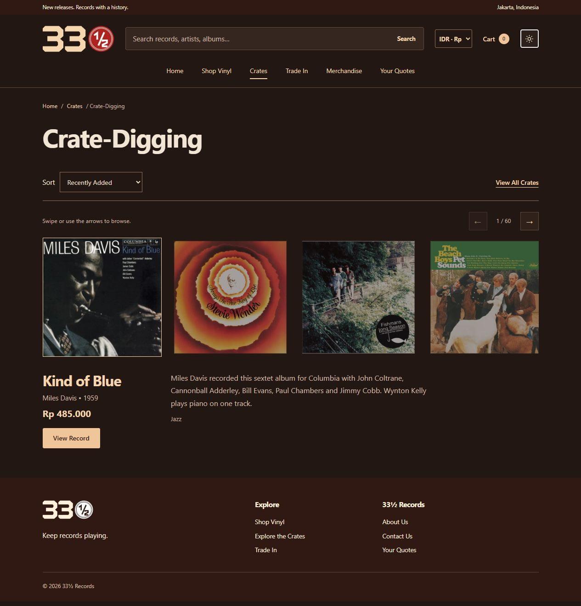
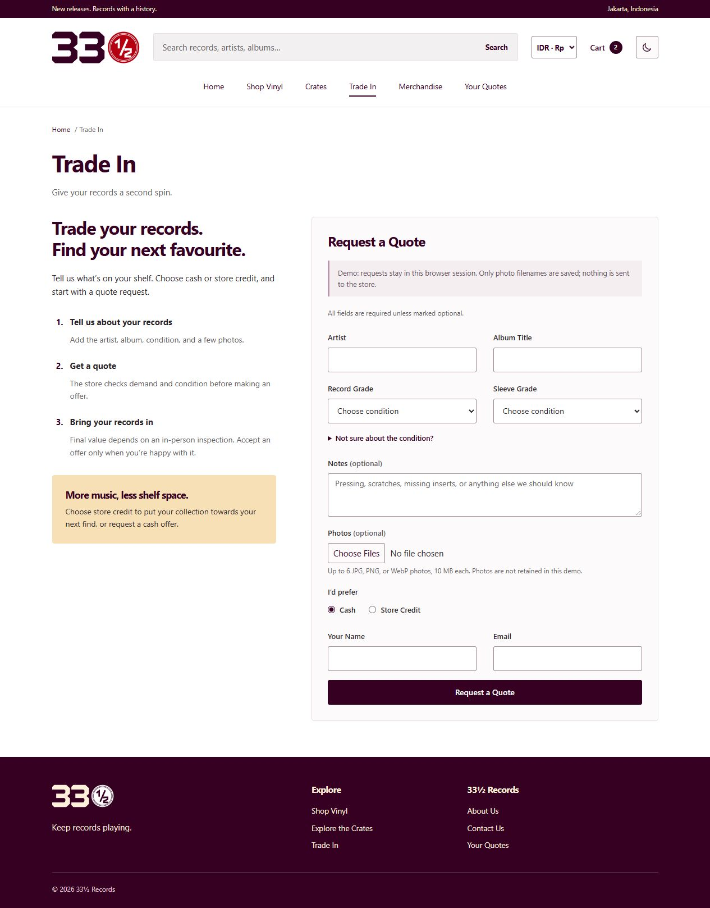
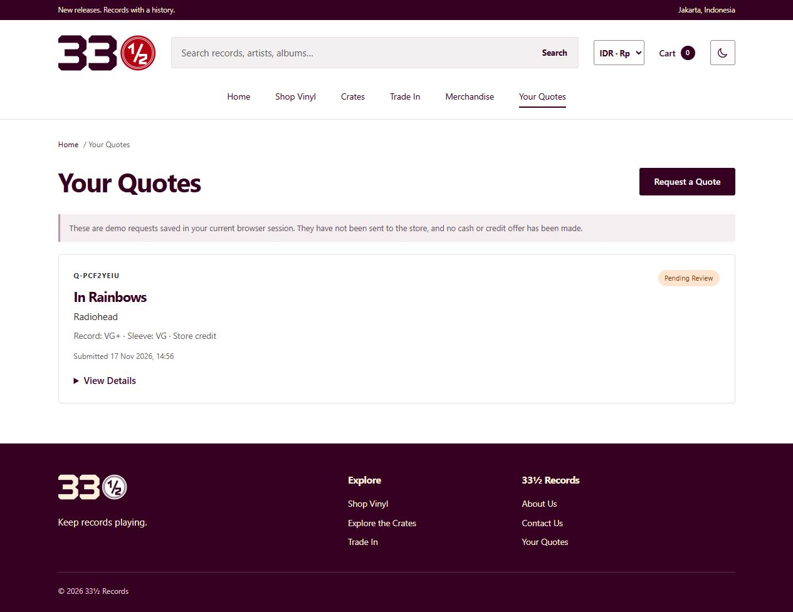
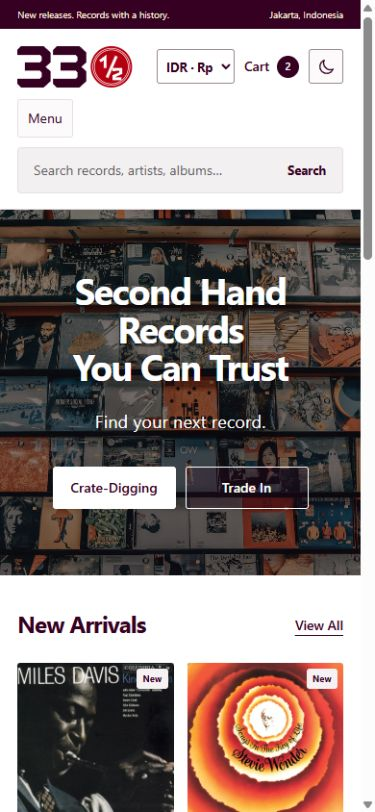

# 33½

A small Laravel storefront scaffold for vinyl records and music related merchandise. It is intentionally a foundation: the catalog, layout, components, and interactions are ready to edit, while checkout and other launch features remain placeholders.

## Screenshots

Select a screenshot to open it at full size.

| Storefront and new arrivals | About Us |
| --- | --- |
|  |  |

| Filtered vinyl catalog | Genre and artist crates |
| --- | --- |
|  |  |

| Crate Digging in dark mode | Record detail and sleeve gallery |
| --- | --- |
|  |  |

| Merchandise | Cart in USD |
| --- | --- |
|  |  |

| Trade-in form | Demo quote history |
| --- | --- |
|  |  |

### Mobile storefront

## Stack

- Laravel 12 / PHP 8.2+
- Blade templates
- MySQL schema (SQLite also works for local demos)
- Local Bootstrap 4 CSS from `public/assets/bootstrap`, plus a custom stylesheet
- Small vanilla JavaScript modules, built with Vite; no jQuery dependency

## Run with XAMPP

1. Start Apache and MySQL in the XAMPP Control Panel.
2. Install dependencies using `composer install` and `npm ci`. Copy `.env.example` to `.env` if needed, then run `php artisan key:generate` for a new environment. Use XAMPP's PHP 8.2+ on your PATH, or run `C:\xampp\php\php.exe artisan`.
3. Use the MySQL settings from `.env.example`. The default schema is `33-half` at `127.0.0.1:3306`. Adjust the account credentials for your installation.
4. Run `php artisan migrate:fresh --seed` on a new or disposable development database. Laravel creates `33-half` if it is missing and the account has permission. This command drops existing tables in the selected database. To keep existing records, run `php artisan migrate` and then `php artisan db:seed`.
5. Run `npm run build`.
6. Copy the directives from [the Apache example](docs/xampp/apache.conf.example) into XAMPP's `apache/conf/extra/httpd-vhosts.conf`. Replace both example paths with your project's absolute `public` folder path. Restart Apache and open [the storefront](http://localhost/33-half/). The database is visible in [phpMyAdmin](http://localhost/phpmyadmin/).

For Laravel's development server, set `APP_URL=http://127.0.0.1:8000` and run `php artisan serve`. For live CSS/JS edits, run `npm run dev` in a second terminal. The test suite uses SQLite in memory.

## Main folders

| Path | Purpose |
| --- | --- |
| `app/Models` | Product, Artist, Genre, Label and their relationships |
| `app/Http/Controllers` | Page, catalog, and session cart logic |
| `database/migrations` | Catalog tables and Laravel's default support tables |
| `database/seeders/CatalogSeeder.php` | 90 chart albums and three merchandise mockups |
| `resources/views/layouts` | Shared HTML shell |
| `resources/views/components` | Reusable storefront pieces |
| `resources/views/pages` | Home, catalog, directory, crate, cart, and information pages |
| `resources/views/products` | Shared product detail page |
| `resources/css/app.css` | Burgundy/cream design and responsive breakpoints |
| `resources/js` | Audio, crate, and cart modules |
| `public/images/demo`, `public/audio` | Local placeholder covers and original demo sound |
| `scripts/generate_demo_assets.py` | Recreates demo artwork and sound |

## Routes

| Route | Page |
| --- | --- |
| `/` | Home |
| `/shop` | All products |
| `/vinyl` | Vinyl |
| `/records/{slug}` | Vinyl detail |
| `/merch`, `/merch/{slug}` | Merchandise and detail |
| `/artists`, `/artists/{slug}` | Artist directory and collection |
| `/genres`, `/genres/{slug}` | Genre directory and collection |
| `/pre-orders` | Upcoming records |
| `/crate-digging` | Horizontal carousel of all records |
| `/crates` | Genre and artist crate directory |
| `/crates/artists/{letter}` | Carousel of artists beginning with a letter |
| `/trade-in` | Demo trade-in request form |
| `/your-quotes` | Quote requests saved in the current session |
| `/cart` | Session cart |
| `/about`, `/contact` | Editable information pages |

The catalog already accepts simple query parameters: `q`, `genre`, `artist`, `label`, `min_price`, `max_price`, `availability`, and `sort`.

## Data model

`products` holds both vinyl and merchandise via `product_type`. Core fields include name, slug, description, price, stock, artwork path, featured/preorder flags, and optional merch category. Record specific fields (release date, format, label, audio preview URL/start time) are nullable where appropriate. Artists and genres are many-to-many with products; labels are one-to-many. Merchandise sizes and variants are an extension point, not inventory managed yet.

The seed data in `database/data/albums.json` follows a [May 2026 snapshot of the Rate Your Music chart](https://www.jetpunk.com/user-quizzes/2747014/100-best-albums-of-all-time). Each album includes a short paraphrase of its Wikipedia introduction, up to three genres, an external artwork URL, and a local WebP copy. Where available, an Apple audio preview is included. Prices, stock, grades, and preorder flags are sample store data.

Product prices are stored in IDR. The header's IDR/USD selector saves a session preference. Set `STOREFRONT_IDR_PER_USD` to the number of rupiah per US dollar to change the site's fixed conversion rate. The default is 16,000.

## Interactive features

- Product card hover previews work on desktop after a page interaction. The play button works by tap or click. A single audio manager ensures that clips never overlap and limits each preview to ten seconds.
- Crate Digging snaps horizontally. The leftmost cover is active, with its title, artist, price, and record link underneath and the album description beside them. Swipe, wheel over the covers, click a cover, or use the buttons or Left/Right keys. Home and End jump to the first and last sleeve.
- Genre, artist, and artist-letter pages reuse the same carousel component. The directory supports All, Genres, and A–Z views plus alphabetical or record-count sorting. Collections can be sorted by artist, album title, or recently added.
- The cart stores product IDs and quantities in the Laravel session. It supports add, update, and remove, but no checkout or payment processing.

The homepage shows four New Arrivals and links to Shop Vinyl. Shop Vinyl displays 48 albums per page, or 12 rows on the desktop grid. Genre aliases are mapped to broader genres by GenreTaxonomy. Record cards show up to two genres and record details show the full normalized list.

The sun/moon toggle follows the system until a theme is selected. It stores the chosen theme in the browser. Record galleries use alternate cover images where available and the front cover as a reference otherwise.

The catalog, merchandise, and crate filters update as you change them. Filter and sort choices stay in the URL for sharing and browser history. The vinyl catalog also accepts `condition=new` or `condition=used`.

The trade-in form saves demo requests in the current Laravel session, and the cart saves quantities as they change. Checkout, order processing and account management are outside this version.

Run `php artisan test` to check the catalog, cart, currency switching, and quotes.
